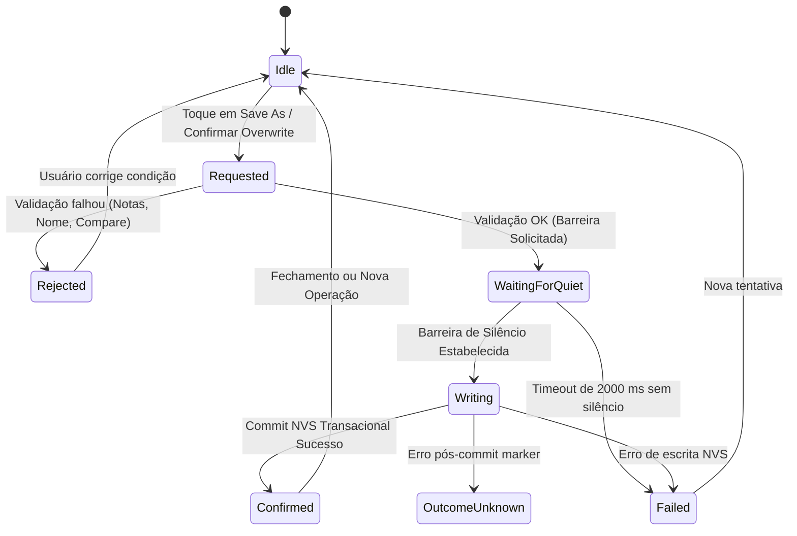
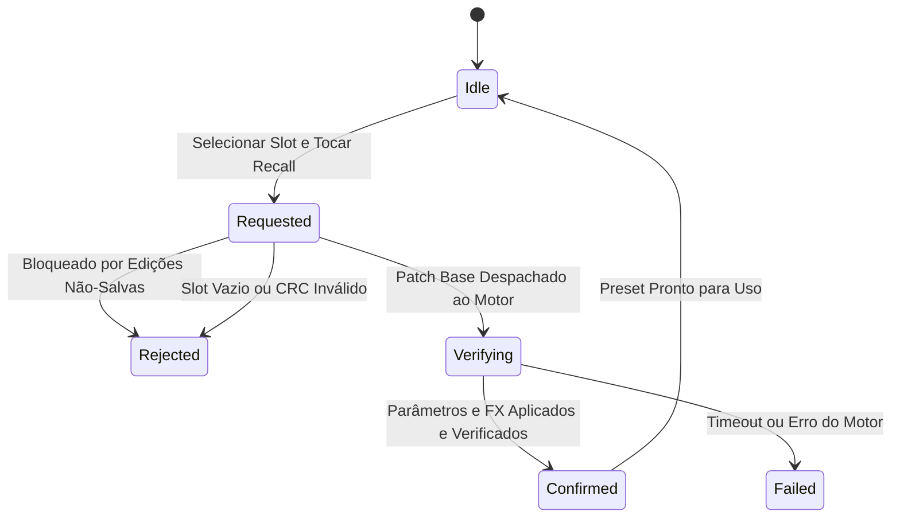

# SMK-P4 0.13.1 — Máquina de Estados e Diagnósticos de User Presets

Recall expires after 2 seconds. The owner drops expired patch, edit and FX requests still queued. A patch load already started can complete. Confirmation requires the expected patch, generation, synth ACK and FX ACK. A marker write with uncertain outcome locks the slot in the running session. A later save attempt only reconciles the matching committed marker and records, and a fresh confirmation is required before writing.

## 1. Visão Geral

Na versão 0.13.1, a gestão de presets do usuário foi completamente consolidada com **acompanhamento assíncrono real** e **diagnósticos tipados de rejeição**, substituindo mensagens genéricas de erro por um modelo determinístico e observável.

---

## 2. Diagnósticos Tipados de Rejeição (`PresetRejectReason`)

A API tipada foi introduzida no backend e adaptada para a interface gráfica:

```cpp
enum class PresetRejectReason : uint8_t {
    None = 0,
    EngineUnavailable,
    Busy,
    SaveInProgress,
    QuietBarrier,
    PendingEdit,
    ActiveNotes,
    SustainActive,
    CompareActive,
    UnsavedSynth,
    UnsavedFx,
    InvalidSlot,
    InvalidName,
    InvalidPreset,
    StorageUnavailable,
    StorageReadError,
    StorageWriteError,
    CommitUncertain,
    OwnerTimeout,
    StaleGeneration
};
```

### Mapeamento de Mensagens na Touchscreen e Serial

| Razão de Rejeição | Notificação na Tela Touch | Log Estruturado Serial |
|---|---|---|
| `ActiveNotes` | `"SAVE BLOCKED: NOTES STILL ACTIVE"` | `PRESET_DIAG reason=ACTIVE_NOTES` |
| `SustainActive` | `"SAVE BLOCKED: SUSTAIN ACTIVE"` | `PRESET_DIAG reason=SUSTAIN_ACTIVE` |
| `CompareActive` | `"OVERWRITE BLOCKED: COMPARE ACTIVE"` | `PRESET_DIAG reason=COMPARE_ACTIVE` |
| `PendingEdit` | `"SAVE BLOCKED: WAITING FOR EDIT OWNER"` | `PRESET_DIAG reason=PENDING_EDIT` |
| `UnsavedSynth` | `"RECALL BLOCKED: UNSAVED SYNTH EDITS"` | `PRESET_DIAG reason=UNSAVED_SYNTH` |
| `UnsavedFx` | `"RECALL BLOCKED: UNSAVED FX EDITS"` | `PRESET_DIAG reason=UNSAVED_FX` |
| `InvalidName` | `"SAVE BLOCKED: INVALID PRESET NAME"` | `PRESET_DIAG reason=INVALID_NAME` |
| `InvalidSlot` | `"PRESET INVALID: SLOT RANGE"` | `PRESET_DIAG reason=INVALID_SLOT` |
| `StorageUnavailable` | `"PRESET STORAGE UNAVAILABLE"` | `PRESET_DIAG reason=STORAGE_UNAVAILABLE` |
| `StorageReadError` | `"PRESET INVALID: SLOT XX"` | `PRESET_DIAG reason=STORAGE_READ_ERROR` |
| `StorageWriteError` | `"SAVE FAILED: NVS ERROR"` | `PRESET_DIAG reason=STORAGE_WRITE_ERROR` |
| `CommitUncertain` | `"SAVE UNCERTAIN: CHECK SLOT XX"` | `PRESET_DIAG reason=COMMIT_UNCERTAIN` |
| `QuietBarrier` | `"SAVE QUIET BARRIER TIMEOUT"` | `PRESET_DIAG reason=QUIET_BARRIER` |

---

## 3. Máquina de Estados Assíncrona (`PresetOperationState`)

```cpp
enum class PresetOperationState : uint8_t {
    Idle = 0,
    Requested,
    WaitingForQuiet,
    Writing,
    Verifying,
    Confirmed,
    Rejected,
    Failed,
    OutcomeUnknown
};
```

### 3.1 Ciclo de Vida: Save As / Overwrite



### 3.2 Ciclo de Vida: Recall



---

## 4. Proteções Transacionais e Concorrência

1. **Quiet Barrier Estrita:** A escrita flash de NVS só ocorre quando o motor confirma `storage_quiet == true`, eliminando underruns e falhas DMA.
2. **Duas Etapas em Overwrite:** Slots ocupados exigem confirmação explícita mostrando `CURRENT` vs `NEW`. Trocar de slot ou editar o nome anula imediatamente a confirmação prévia.
3. **Preservação de Edições Não-Salvas:** O comando `Recall` rejeita categoricamente sobrescrever edições em andamento sem `Revert` ou `Save` prévio.
