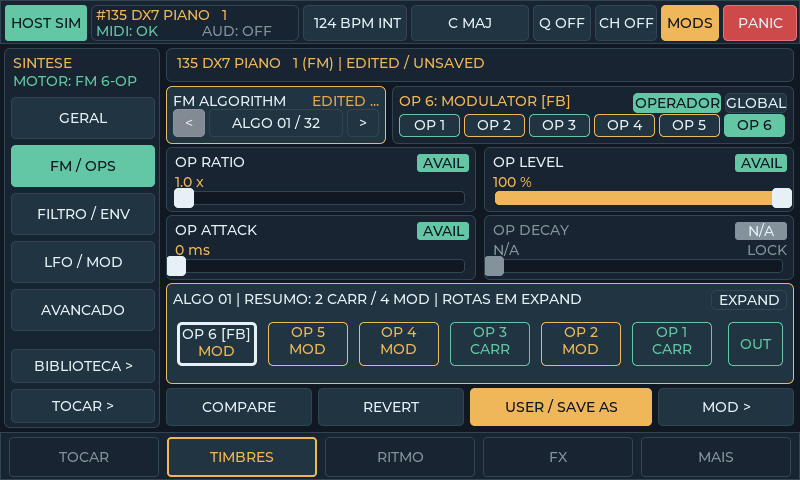
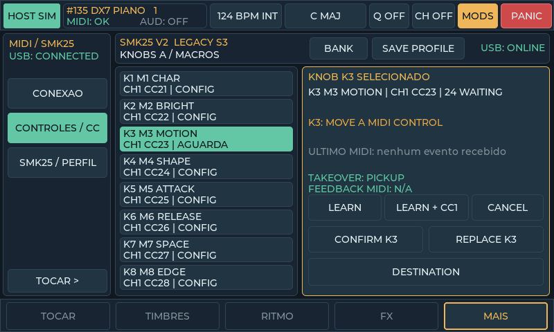

# SMK-P4 0.18-C.2a — FM Editor UX, MIDI Learn e ciclo de vida LVGL

Data: 24/11/2026. Branch: `feature/smk-p4-ui-redesign-018c2a`.
Base remota conferida por `git ls-remote origin`: `6245e00645b4dd0477894229cd905890324f03a2`.
Os cinco commits locais posteriores encontrados no início foram preservados.
SHA de código submetido à validação limpa:
`640e2f8ff06e157ad0ce1f3b16b03bb43cf8ac88`.
O commit posterior de documentação/capturas não altera os fontes testados.

## Escopo e arquitetura

O pedido explícito desta etapa usa ESP32-P4, Guition e LVGL 800×480; prevalece
sobre `specs.md`/`AGENTS.md` antigos, que descrevem S3 e 284×76. A alteração
permanece no frontend, testes e no helper gráfico `amy_runtime/fm_topology.h`.
Nenhuma alteração em `src/`, Audio Owner, adaptador musical em `main/`, I²S,
USB Host, algoritmos FM, índices, armazenamento ou representação dos patches.
Nenhuma dependência nova. Nenhum flash, monitor serial ou merge em `main`.

Os PNGs da pasta histórica `ui_018c2_shots` já estavam modificados no início;
foram preservados fora dos commits desta etapa. A evidência nova está em
`ui_018c2a_shots/`.

## Auditoria inicial

As referências abaixo são da base `6245e006`, permitindo conferir o defeito
original mesmo após a mudança de linhas. Capturas originais foram extraídas
diretamente desse commit, sem usar os PNGs locais modificados.

| Classificação | Arquivo:linha na base | Evidência / causa |
|---|---|---|
| Confirmado visualmente | `screens/sound_editor_screen.cpp:164` | `06_sintese_fm.png`, `09_sintese_compare.png`: oito cartões de 152 px comprimem nomes e badges; controles e topologia disputam a faixa inferior. |
| Confirmado no código e imagem | `widgets/fm_algorithm_selector.cpp:93`, `screens/sound_editor_screen.cpp:175` | Layout calculado em 576×78 para um widget de 480 px, ainda antes de descontar borda/padding. Nós e texto ultrapassam a área útil. |
| Confirmado visualmente | `widgets/parameter_card.cpp:71`, `widgets/parameter_slider.cpp:564` | Badge em `w-62` sem reserva equivalente no título. `06`/`09` mostram colisões em Ratio, Level, Attack, Decay e Feedback. |
| Confirmado visualmente | `screens/midi_screen.cpp:178` | `14_midi_controles_cc.png`, `15_midi_learn.png`: oito grupos simultâneos, confirmação global e pouca associação visual com o knob alvo. |
| Confirmado visualmente | `screens/midi_screen.cpp:256` | `13_midi_conexao.png`: estado USB truncado e linha de capacidades cortada; `14`/`15`: perfil e texto técnico competem com ações. |
| Risco estático, sem crash reproduzido na base | `screens/midi_screen.cpp:182,209,325,332` | Navegação imediata a partir do callback que pertence ao painel desmontado. |
| Risco estático, sem crash reproduzido na base | `widgets/fm_algorithm_selector.cpp:293,432`, `screens/sound_editor_screen.cpp:498` | Exclusão síncrona do modal no callback de um filho; referências e confirmações precisam respeitar o teardown. |
| Confirmado no script | `tests/run_ui_018c2.ps1` | Reutilização de objetos externos sem comprovação dos fontes/flags que os produziram. |

Caminhos `screens/` e `widgets/` nesta tabela são relativos a
`smk-p4/components/ui_blueprint/`; `tests/` é relativo a `smk-p4/`.

Na revisão complementar, confirmou-se que os modais FM são filhos da tela LVGL,
fora de `content_root_`: seus callbacks `LV_EVENT_REFRESH` não recebiam o refresh
recursivo do conteúdo. A mudança adiciona `refreshFmModals()` e o chama na
atualização da tela de síntese. A troca de patch fecha modais mesmo entre dois
patches FM, sem depender apenas da mudança de família.

## Editor FM e geometria

- Cabeçalho: algoritmo, OP1–OP6, papel carrier/modulator e abas internas.
- `OPERADOR`: Ratio, Level, Attack e Decay em quatro cartões de 310 px.
- `GLOBAL`: Depth, Feedback, sensibilidade à velocidade do operador e seleção
  de operador; nenhuma funcionalidade anterior foi removida.
- Rodapé: resumo dos seis operadores e OUT; `EXPAND` abre o roteamento completo.
  O resumo identifica explicitamente sua natureza e não simula conexões.
- A seleção do operador permanece no modelo ao trocar de painel; montar a UI
  não emite alterações de síntese.
- O diagrama lê `lv_obj_get_content_width/height()` após layout e estilos.
  Cabeçalho, legenda e status têm áreas separadas. Os nós selecionados usam
  borda branca; carriers usam verde e texto, modulators âmbar e texto.
- O helper de desenho desvia o barramento de áudio abaixo dos carriers e liga
  feedback ao operador de origem real, inclusive feedback entre operadores.
  `deriveTopology()` e a tabela AMY de 32 algoritmos não foram alterados.
- Cartões reservam largura exclusiva de 52 px para badges; em larguras menores
  de 145 px o badge vai para a linha secundária. Nomes longos usam reticências
  dentro da área reservada; aliases musicais não mudam IDs do registry.

A auditoria quantitativa identificou ainda uma interseção de 1 px entre badge e
região de estado dos cartões baixos e uma interseção com o botão `+` do seletor
de operador. Foram corrigidas as alturas das regiões e dos controles; a asserção
foi ampliada para sliders e botões, sem relaxar os limites. Os seletores usam
cores imediatas, evitando o texto preto sobre o fundo escuro durante o fade do
tema padrão. O seletor de algoritmos também acompanha alterações confirmadas
externamente ao próprio modal; apenas um botão mantém `ACT` e destaque ativo.

Os testes geram geometria em 614×66 e 706×258 para os 32 algoritmos e verificam
seis operadores únicos, OUT, limites, quantidade/tipos/destinos das conexões e
extremidades nas bordas dos nós corretos. A UI montada percorre os 32 algoritmos
e todas as seis seleções, incluindo comando de algoritmo pendente e seleção
inválida rejeitada. O compacto visível é um resumo; o grafo completo fica no
expandido. A auditoria LVGL também verifica contenção nos pais e viewport,
regiões reservadas de badges/títulos e ações dentro do conteúdo.

Os estados contextuais `N/A` anteriores foram preservados: por exemplo, ratio de
operador em frequência fixa ou decay fora da faixa do editor simplificado.
Isso não foi convertido em um controle demonstrativo nem em suporte DSP novo.

## MIDI Learn

Lista K1–K8 à esquerda, nome resumido e canal/CC em linhas próprias. Painel
contextual à direita identifica `KNOB Kn SELECIONADO`, destino, pickup, mensagem
de Learn, observação do MIDI e ações `LEARN`, `LEARN + CC1`, `CANCEL`,
`CONFIRM Kn`, `REPLACE Kn` e `DESTINATION`. Banco e Save Profile permanecem no
topo. O estado USB offline fica explícito; mensagens longas usam duas linhas.

Trocar de knob ou sair do painel cancela um Learn ativo antes que outra
confirmação possa sugerir o alvo errado. Não confirma nem substitui associações
implicitamente. Bancos, canais, SMK25, pickup, Replace e Save Profile continuam
usando as APIs musicais existentes. Feedback MIDI de saída não foi adicionado.
O banco também cancela a associação pendente com mensagem explícita. O painel
mostra `ULTIMO MIDI`, `TAKEOVER: PICKUP` e `FEEDBACK MIDI: N/A`, sem repetir
permanentemente o texto técnico de bancos físicos. A página de perfil conserva
essa observação detalhada. A seleção dos oito knobs testa tanto o estado checked
quanto a cor efetiva, para impedir dois destaques ou contraste insuficiente.

Capturas usam LVGL 9.3 e AMY reais em host, com pacotes USB MIDI injetados.
`HOST SIM` identifica a origem. Nenhuma imagem comprova recepção física USB.

## Ciclo de vida

Foi inspecionado o código LVGL 9.3 instalado em
`managed_components/lvgl__lvgl/src/core/lv_obj_tree.c`: `lv_obj_delete_async()`
agenda a exclusão por `lv_async_call`; a destruição cancela exclusões assíncronas
pendentes para o mesmo objeto. `LV_EVENT_DELETE` libera contextos dos widgets.
Não se assumiu que toda exclusão dentro de evento é necessariamente inválida.
Também foi conferido `src/core/lv_obj.c`: a LVGL 9.3 desreferencia um descritor
de transição registrado. O código final remove os estilos de transição do tema
nos seletores em vez de registrar um descritor nulo. A posição e o tamanho
explícitos são preservados pelo helper de estilo.

Callbacks que desmontam MIDI, síntese e biblioteca usam os pedidos diferidos já
existentes em `UiNavigationManager`; a execução ocorre fora do callback.
Fechamentos de modais ocultam o objeto, retiram a referência ativa e agendam
exclusão. O `onDestroy()` do proprietário fecha modais remanescentes antes de
liberar a tela. Confirmações FM são reconciliadas com token e estado confirmado;
o badge `ACT` acompanha o algoritmo confirmado e `WAIT` identifica o pendente.
O PANIC do cabeçalho fecha os modais FM uma vez, no callback da ação, em vez de
reprocessar um `lastCommandParameterId == "panic"` persistente a cada refresh.
A regressão reabre o modal sem editar o patch, força refresh e repete PANIC,
verificando visibilidade real e recuperação. Fechar User Presets não emite um comando musical nem
um cancelamento de armazenamento já solicitado.

## Reprodutibilidade

```powershell
powershell -ExecutionPolicy Bypass -File smk-p4/tests/run_ui_018c2.ps1 -Clean -Regressions
```

O script constrói seus próprios 240 objetos LVGL, 20 objetos AMY e 34 objetos UI.
Não usa `build/ui_blueprint_host/ui_obj` nem os objetos de `build/harmony09`.
Verifica GCC/G++, ar, Git, Python, Pillow e LVGL; falhas de compile/link/run são
terminantes. Usa C99/gnu11/C++20, O2, flags musicais do editor de oito vozes,
48 kHz/256 frames, pool LVGL 128 KiB e `-fno-strict-aliasing` como o runtime.
SHA256 dos fontes/headers, configuração, script e versões das ferramentas
invalidam o cache. O stamp é retirado antes do build e só é escrito após sucesso.
`build/ui_018c2/test_manifest.json` registra commit, branch, dirty state, hashes,
flags, compiladores, contagens e resultado. `-Regressions` recompila C.1, C.1a e
Sound Editor/SMK25 usando as mesmas dependências recém-construídas.

Compilador desta execução: GCC/G++ 14.2.0, MinGW-W64 UCRT x86-64.

## Resultados

Todas as suítes host abaixo foram executadas em build limpo (`-Clean -Regressions`)
sobre o commit `640e2f8ff06e157ad0ce1f3b16b03bb43cf8ac88`, gerando `build/ui_018c2/test_manifest.json`
com `result: PASS` (240 objetos LVGL, 20 objetos AMY, 34 objetos UI).

| Suíte / verificação | Resultado | Métricas LVGL / TLSF (início → fim, pico, frag.) |
|---|---|---|
| `ui_018c2_test` (C.2 + C.2a: 32 algos, 6 ops, MIDI Learn, stress) | `PASS` | C.2: `objs=91→91`, `free=74632→74632 B`, `largest=73624→73624 B`, `diff=0`, `peak=89728 B`, `frag=2%→2%`<br>C.2a: `objs=91→91`, `free=74632→74632 B`, `largest=73624→73624 B`, `diff=0`, `peak=100680 B`, `frag=2%→2%` |
| `ui_018c1_integration_test` (500 navs, notas/Arp/Seq, Lock) | `PASS` | `objs=91→91`, `free=74656→74656 B`, `largest=73648→73648 B`, `diff=0`, `peak=75472 B`, `frag=2%→2%` (500 nav host: mediana 3798,8 µs, P95 6530,4 µs, max 7966,9 µs) |
| `ui_018c1a_hardening_test` (Scene Safety, Harmony Overlay) | `PASS` | `objs=91→91`, `free=75744→75744 B`, `largest=74680→74680 B`, `diff=0`, `peak=66816 B`, `frag=2%→2%` |
| `sound_editor_ui_test` + `smk25_0142_ui_test` | `PASS` | `objs=96→96`, `free=75600→75600 B`, `largest=75536→75536 B`, `diff=0`, `peak=81320 B`, `frag=1%→1%` (500 nav FX); Inspector 50-toggle `diff=0 B`; Idle 200-ticks `diff=0 B` |

Validação complementar, executada pelo script de preview existente (separada do
build limpo acima):

| Comando | Resultado | Evidência |
|---|---|---|
| `powershell -ExecutionPolicy Bypass -File smk-p4/ui-preview/run_preview.ps1` | `PASS` | Sete grupos de testes, limites 800×480, 700 montagens: `free=71632→71632 B`, `diff=0 B`, `peak=105176 B`, `frag=0%`; 23 previews em `build/ui_preview_shots/`. |

Builds finais executados:

```powershell
C:/.platformio/penv/Scripts/pio.exe run -d smk-p4 -e guition-editor-8 -e guition-editor-8-bench -j 8
python smk-p4/tests/check_blueprint_build.py --voices 8 --sound-library --unified-engine --harmony --full-factory --sound-editor --environment guition-editor-8
python smk-p4/tests/check_blueprint_build.py --voices 8 --sound-library --unified-engine --harmony --full-factory --sound-editor --musical --environment guition-editor-8-bench
```

| Perfil | Build / auditoria | RAM estática | Flash | Delta RAM / Flash vs C.2 |
|---|---|---:|---:|---:|
| `guition-editor-8` | `PASS` / `PASS` | 70.272 B (21,4%) | 1.514.978 B (9,0%) | +8 / +20.726 B |
| `guition-editor-8-bench` | `PASS` / `PASS` | 70.828 B (21,6%) | 1.620.468 B (9,7%) | +8 / +20.726 B |

Sem warnings ou erros nos logs finais P4. Valores de referência C.2 vêm do
relatório anterior, não de uma nova compilação da base. O pool LVGL continua
128 KiB. Métricas de tempo em host não qualificam deadlines no ESP32-P4.
Tamanhos reais de `firmware.bin`: 1.515.712 B (`guition-editor-8`) e 1.621.200 B (`guition-editor-8-bench`).

**Veredito: `CONDITIONAL GO` (host e compilação P4 aprovados; qualificação física `MANUAL` adiada por decisão do usuário — não qualificado para palco).**

### Falha herdada fora do perfil editor

**FAIL:** `run_amy.ps1 -Voices 8 -SoundLibrary` falha em
`tests/polyphony_test.cpp:82`, no orçamento legado do motor. A mesma execução
falhou em checkout isolado da base `6245e006`, na mesma asserção. Inicialização
AMY e teste musical USB anteriores a ela passaram em ambos os checkouts.
Uma cópia diagnóstica do teste, apenas com `fflush(stdout)` antes da asserção,
mediu pico de 952.186 B contra limite de 307.200 B. A asserção original foi
preservada; esse perfil não é o editor full-factory validado acima. Não se declara
a suíte legada completa como PASS. Logs locais: `build/ui_018c2a_amy.log`,
`build/ui_018c2a_amy_baseline.log`, `build/ui_018c2a_polyphony_probe.log`.

## Capturas LVGL 800×480

Todas as imagens são renders LVGL reais, com AMY real e MIDI **simulado no
host**, identificado no cabeçalho. São 16 vistas exigidas, uma vista USB offline
adicional e 20 vistas de regressão C.2 na pasta `ui_018c2a_shots/`.
As 16 vistas exigidas foram revistas visualmente após a validação final: não
foram observadas sobreposições relevantes nos painéis FM nem cortes importantes
nos textos contextuais MIDI. Reticências em títulos/status secundários continuam
intencionais; a auditoria geométrica complementa essa revisão visual.

| Vista exigida | Captura |
|---|---|
| FM global | [01_fm_visao_global.png](ui_018c2a_shots/01_fm_visao_global.png) |
| Operador 1 | [02_fm_op1.png](ui_018c2a_shots/02_fm_op1.png) |
| Operador 6 | [03_fm_op6.png](ui_018c2a_shots/03_fm_op6.png) |
| Algoritmo 1 | [04_fm_algo_01.png](ui_018c2a_shots/04_fm_algo_01.png) |
| Algoritmo 9 | [05_fm_algo_09.png](ui_018c2a_shots/05_fm_algo_09.png) |
| Algoritmo 16 | [06_fm_algo_16.png](ui_018c2a_shots/06_fm_algo_16.png) |
| Algoritmo 32 | [07_fm_algo_32.png](ui_018c2a_shots/07_fm_algo_32.png) |
| Topologia expandida | [08_fm_topologia_expandida.png](ui_018c2a_shots/08_fm_topologia_expandida.png) |
| Seletor de algoritmos | [09_fm_selecao_algoritmo.png](ui_018c2a_shots/09_fm_selecao_algoritmo.png) |
| Mudança rejeitada | [10_fm_mudanca_rejeitada.png](ui_018c2a_shots/10_fm_mudanca_rejeitada.png) |
| Lista de knobs | [11_midi_lista_knobs.png](ui_018c2a_shots/11_midi_lista_knobs.png) |
| Knob selecionado | [12_midi_knob_selecionado.png](ui_018c2a_shots/12_midi_knob_selecionado.png) |
| Learn aguardando CC | [13_midi_learn_aguardando.png](ui_018c2a_shots/13_midi_learn_aguardando.png) |
| Associação confirmada | [14_midi_associacao_confirmada.png](ui_018c2a_shots/14_midi_associacao_confirmada.png) |
| Destino do controle | [15_midi_destino_controle.png](ui_018c2a_shots/15_midi_destino_controle.png) |
| User Presets / Save As | [16_user_presets_save_as.png](ui_018c2a_shots/16_user_presets_save_as.png) |
| USB offline adicional | [17_midi_usb_offline.png](ui_018c2a_shots/17_midi_usb_offline.png) |





## Hardware, riscos e próxima etapa

**MANUAL — adiado:** Guition/GT911, PCM5102A, VBUS, conexão e reconexão físicas
SMK25, latência e underruns reais. Nenhum GPIO ou circuito foi inventado.
Não está qualificado para palco. Os testes host complementam, sem substituir,
inspeção visual e qualificação física.

### Plano C.3 — Rhythm Performance UX (não implementado)

| Etapa pequena | Escopo | Aceitação proposta |
|---|---|---|
| Auditoria e wireframes | Mapear controles atuais de Arp, Seq e padrões; desenhar PLAY/EDIT em 800×480. | Navegação entre vistas preserva USB, sustain, notas e fase musical; estado ativo separado da pré-seleção. |
| Performance Arp / transporte | Organizar Enable, Play/Stop, latch, direção, divisão, gate e swing existentes; indicar relógio/BPM global. | Stop por fonte, Panic e sincronização conservam contratos; sem novo relógio ou DSP. |
| Sequenciador PLAY / EDIT | Separar transporte, Live Transpose e execução da edição de nota, velocity, gate e Step Recording. | Editar não reinicia transporte nem perde notas; Q harmônico e quantização do sequenciador permanecem independentes. |
| Padrões / integração Scenes | Organizar biblioteca existente e ações destrutivas confirmadas; mostrar vínculo com cena ativa e relógio. | Formatos persistidos, carga segura e semântica de cenas preservados; sem encadeamento novo. |

Validar cada etapa em host antes da seguinte: capturas LVGL, geometria, regressões
musicais, 500 navegações, ausência de crescimento líquido TLSF e dois builds P4.
Próximo menor passo: revisar esses wireframes e critérios em host. A investigação
do orçamento legado segue separada; a qualificação física permanece adiada por
decisão do usuário.
