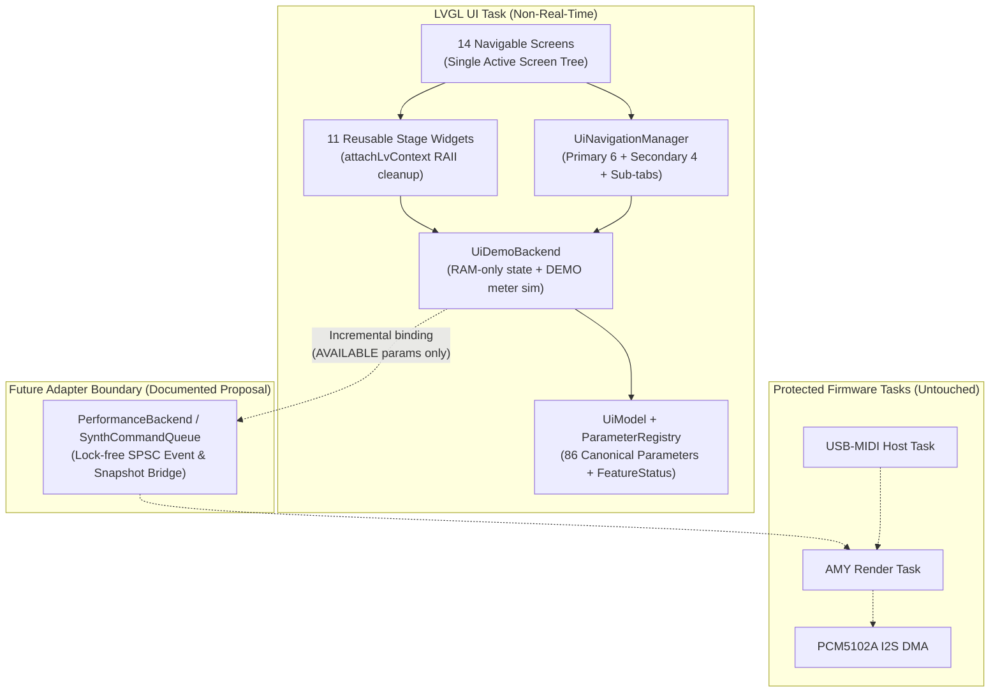

# SMK-P4 UI Blueprint 1.0 — Visual & Software Architecture

## 1. Purpose and Scope

`smk-p4/components/ui_blueprint` defines the complete `800 × 480` horizontal LVGL 9.3.0 user interface architecture for the **Guition JC-ESP32P4-M3** (`ST7701S` MIPI-DSI panel + `GT911` capacitive touch).

It is designed around the **Central Separation Principle** mandated by the SMK-P4 UI Blueprint 1.0 specification:

1. **Visual Interface (`screens/`, `widgets/`, `ui_theme.*`)**: Pure LVGL 9.3.0 presentation and touch interaction on a fixed `800 × 480` landscape canvas.
2. **Parameter Model (`ui_parameters.*`, `ui_model.*`)**: Canonical metadata registry (`132` parameters across `18` namespaces) with explicit range, unit, scale, synth-family capability masks, and `FeatureStatus` (`AVAILABLE`, `PLANNED`, `UNAVAILABLE`, `DEMO`).
3. **Navigation (`ui_navigation.*`)**: Two-tier stage/edit navigation (`PERFORMANCE`, `SOUND`, `LAYERS`, `FX`, `SEQ`, `HARMONY` + `PATCHES`, `MIDI`, `SETTINGS`, `DIAGNOSTICS` + contextual access to `MIXER`, `MODULATION`, `ARPEGGIATOR`, `DRUMS`) with single-active-screen memory discipline, sub-tab state persistence, and 1-tap return to `PERFORMANCE`.
4. **Demonstrative State (`ui_demo_backend.*`)**: Self-contained, RAM-only interactive backend (`UiDemoBackend`) that drives the entire 14-screen prototype, simulates clearly labeled `DEMO` signal meters, computes real-time scale/chord harmonic previews, and measures genuine LVGL 9.3.0 heap telemetry without touching hardware or fabricating fake DSP/DMA metrics.
5. **Real Musical Backend (External / Untouched)**: `smk-p4/components/amy_runtime`, `audio_pcm5102`, `usb_midi_host`, and `smk-p4/main/performance_backend.h` remain untouched and isolated on the real-time firmware path.



---

## 2. Component Directory Layout

```text
smk-p4/components/ui_blueprint/
├── CMakeLists.txt
├── include/
│   ├── ui_blueprint.h        # Top-level facade (begin, service, navigation, backend)
│   ├── ui_demo_backend.h     # Demonstrative RAM-only backend & LVGL heap monitor
│   ├── ui_model.h            # Complete synth/layer/mod/seq/drum/harmony/midi state
│   ├── ui_navigation.h       # ScreenId, sub-tab state, history stack, 1-tap Performance
│   ├── ui_parameters.h       # ParameterId, ParameterSpec, FeatureStatus, ParameterRegistry
│   ├── ui_screens.h          # Factory declarations for all 14 ScreenView implementations
│   ├── ui_theme.h            # 800x480 geometry constants, industrial palette, styles
│   └── ui_widgets.h          # Reusable stage widgets + LV_EVENT_DELETE context cleanup
├── src/
│   ├── ui_blueprint.cpp
│   ├── ui_demo_backend.cpp
│   ├── ui_model.cpp
│   ├── ui_navigation.cpp
│   ├── ui_parameters.cpp
│   └── ui_theme.cpp
├── widgets/
│   ├── status_strip.cpp      # 800x40 top telemetry bar + persistent UI DEMO badge
│   ├── tab_bar.cpp           # 800x46 bottom navigation bar + sub-tab strip
│   ├── parameter_knob.cpp    # Touch arc rotary control + status badge + reset
│   ├── parameter_slider.cpp  # Horizontal touch slider + status badge
│   ├── parameter_card.cpp    # Compact stage macro card + touch bar + +/- buttons
│   ├── patch_selector.cpp    # Hero patch banner with prev/next/browser/reset actions
│   ├── virtual_keyboard.cpp  # Interactive 2-octave keyboard with split & harmony overlay
│   ├── step_grid.cpp         # 16-step sequencer grid + 4x16 drum matrix
│   ├── envelope_editor.cpp   # Interactive ADSR curve visualizer (lv_line)
│   ├── modulation_matrix.cpp # Touch-friendly 4-row paged modulation slot editor
│   └── signal_meter.cpp      # Stereo meter bar with mandatory DEMO SIMULATED label
├── screens/
│   ├── performance_screen.cpp
│   ├── patch_browser_screen.cpp
│   ├── sound_editor_screen.cpp
│   ├── layers_screen.cpp
│   ├── mixer_screen.cpp
│   ├── modulation_screen.cpp
│   ├── effects_screen.cpp
│   ├── arpeggiator_screen.cpp
│   ├── sequencer_screen.cpp
│   ├── drums_screen.cpp
│   ├── harmony_screen.cpp
│   ├── midi_screen.cpp
│   ├── settings_screen.cpp
│   └── diagnostics_screen.cpp
└── tests/
    └── blueprint_test_suite.cpp
```

---

## 3. Fixed 800 × 480 Viewport & Industrial Visual Language

All layouts are strictly authored for the `800 × 480` horizontal frame (`layout::kScreenWidth = 800`, `layout::kScreenHeight = 480`):

| Region | Coordinates (`x, y, w, h`) | Purpose |
|---|---|---|
| **Top `StatusStrip`** | `(0, 0, 800, 40)` | Active patch summary, MIDI/Audio/Voice/BPM/Scale pills, persistent `UI DEMO` badge, `1-Tap PERF` return button, and `PANIC` button. |
| **Screen Content Area** | `(0, 40, 800, 394)` | Active screen viewport (`394 px` height). `PERFORMANCE` uses zero vertical scrolling; all non-scroll containers are verified by automated bounding-box tests. |
| **Bottom `TabBar`** | `(0, 434, 800, 46)` | 6 Primary stage destinations (`PERF`, `SOUND`, `LAYERS`, `FX`, `SEQ`, `HARMONY`) + 4 Secondary destinations (`PATCHES`, `MIDI`, `SETUP`, `DIAG`). |

### Color Palette (`ui_theme.h`)

| Role | Hex | Constant |
|---|---|---|
| Main Background | `#101820` | `palette::kBgMain` |
| Panel Surface | `#192630` | `palette::kPanel` |
| Highlighted Panel | `#253742` | `palette::kPanelHighlight` |
| Primary Text | `#E6EDF2` | `palette::kTextPrimary` |
| Secondary Text | `#80919F` | `palette::kTextSecondary` |
| Primary Accent | `#EAB65B` | `palette::kAccentPrimary` |
| Active / Available | `#67C4A5` | `palette::kActive` |
| Warning / Planned | `#E4A44D` | `palette::kWarning` |
| Error / Panic | `#C94A4A` | `palette::kErrorPanic` |
| Borders | `#354751` | `palette::kBorder` |

---

## 4. Memory Discipline & Zero-Leak Screen Lifecycle

Embedded LVGL interfaces that instantiate all screens simultaneously suffer from high RAM usage, widget fragmentation, and sluggish redraws. `UiBlueprint` enforces a **Single Active Screen Tree** policy:

1. **Persistent Chrome, Ephemeral Screen Content**:
   - `StatusStrip` (`y: 0..40`) and `TabBar` (`y: 434..480`) are created once on `UiBlueprint::begin()`.
   - `content_root_` (`y: 40..434`) holds **only** the currently active `ScreenView`.
2. **Deterministic Teardown on Navigation**:
   - When navigating from Screen $A$ to Screen $B$, `UiNavigationManager::mountActiveScreen()` calls `active_view_->onUnmount()`, destroys the `ScreenView` wrapper, and calls `lv_obj_clean(content_root_)` before constructing Screen $B$.
3. **Automatic Event Context Cleanup (`attachLvContext<T>`)**:
   - Every interactive widget callback state allocated via `lv_malloc` is bound to its owning `lv_obj_t*` via `LV_EVENT_DELETE` (`lv_free`).
   - Verified by `blueprint_test_suite.exe`: cycling across all 14 screens 50 times (`700` full screen builds and teardowns) leaks **0 bytes** of LVGL heap.

---

## 5. Feature Honesty & Capability Gating

Every parameter in `ParameterRegistry` carries a static `FeatureStatus` and capability mask, evaluated dynamically by `UiModel::effectiveStatus(id)`:

- **`AVAILABLE` (`#67C4A5`)**: End-to-end support exists in the current `smk-p4` standalone runtime (`PerformanceState` / `AmyRuntime`: program 128/135, master volume, expression, pitch bend, sustain, panic, octave shift).
- **`PLANNED` (`#E4A44D`)**: Present in `smk-s3` or upstream AMY DSP (`src/`), or specified in `specs.md`, awaiting P4 bridge exposure (e.g., Filter Cutoff/Resonance,Chorus/Reverb/Echo, ADSR, LFO, FM Operators, Split/Layers, Sequencer, Scale/Chord assist). Interactive in the UI model so workflow and layout can be tested today, with a clear `PLANNED` badge and status notice.
- **`UNAVAILABLE` (`#80919F`)**: Inapplicable to the active synthesis family (e.g., FM operator controls when a Subtractive patch is loaded, or Pulse Width when waveform is not Pulse) or blocked by hardware dependencies. Controls are visually dimmed and touch-disabled.
- **`DEMO` (`#EAB65B`)**: Driven by `UiDemoBackend` (e.g., simulated signal meters explicitly tagged `DEMO SIM`).

---

## 6. Incremental Integration Proposal (Without Touching Protected Files)

To integrate `ui_blueprint` into `smk-p4/main/` in future firmware milestones without violating real-time constraints:

1. **Add `ui_blueprint` to `smk-p4/main/CMakeLists.txt` `PRIV_REQUIRES`** when ready to switch from the minimal `PerformanceUi` to `UiBlueprint`.
2. **Implement a `PerformanceBackendBridge` adapter**:
   - On `UiDemoBackend` changes to `FeatureStatus::Available` parameters (`PerfPatchProgram`, `PerfMasterVolume`, `PerfOctaveShift`, `Panic`), forward the event to the existing `PerformanceBackend` interface (`selectProgram()`, `resetControllers()`, etc.).
   - On periodic `UiBlueprint::service(now_ms)` ticks (in the low-priority UI task), read the lock-free `PerformanceState` snapshot (`usb_midi_online`, `audio_ready`, `active_notes`, `underruns`, `render_max_us`) and populate `UiModel::diagnostics()`.
3. **Promote `PLANNED` Parameters Incrementally**:
   - As `AmyRuntime` exposes bounded command queues for filter cutoff, chorus/reverb/echo, and ADSR, flip each corresponding `ParameterSpec::status` from `FeatureStatus::Planned` to `FeatureStatus::Available` in `ui_parameters.cpp`—zero screen layout changes required.
