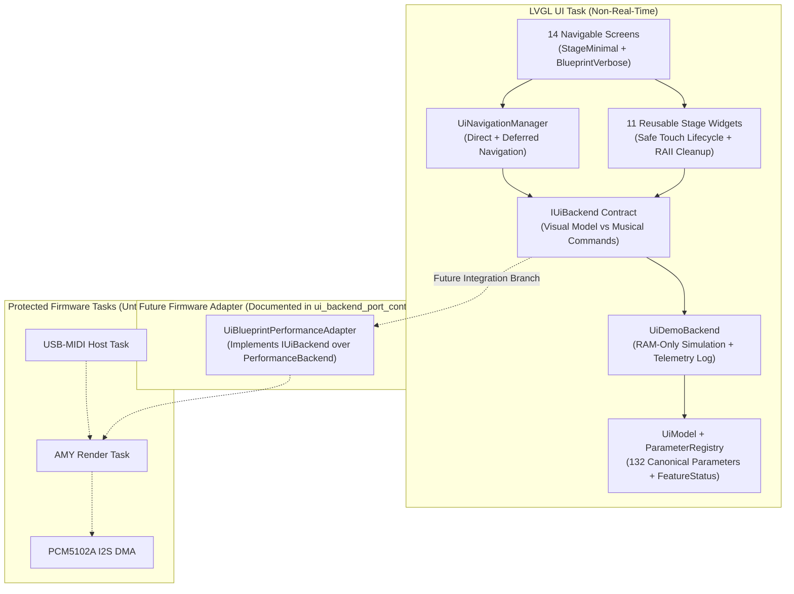

# SMK-P4 UI Blueprint 1.1 — Visual & Software Architecture

## 1. Purpose and Scope

`smk-p4/components/ui_blueprint` defines the complete `800 × 480` horizontal LVGL 9.3.0 user interface architecture for the **Guition JC-ESP32P4-M3** (`ST7701S` MIPI-DSI panel + `GT911` capacitive touch).

In **UI Blueprint 1.1** (`feature/smk-p4-ui-integration-ready`), the visual library is fully decoupled from `UiDemoBackend` through the generic [`IUiBackend`](file:///C:/Users/devx/Documents/PlatformIO/Projects/amy/build/worktrees/smk-p4-ui-integration-ready/smk-p4/components/ui_blueprint/include/ui_backend.h) contract:

1. **Visual Interface (`screens/`, `widgets/`, `ui_theme.*`)**: Pure LVGL 9.3.0 presentation and touch interaction on a fixed `800 × 480` landscape canvas, with two presentation density levels (`PresentationLevel::StageMinimal` on `PERFORMANCE` and `PresentationLevel::BlueprintVerbose` on editor/system screens).
2. **Backend Contract (`ui_backend.h`)**: Defines `IUiBackend`, `UiCommandState` (`Confirmed`, `Requested`, `DemoApplied`, `Unsupported`, `Rejected`), and `UiCommandResult`, separating the visual snapshot (`model()`) from musical command requests (`requestParameter*`, `requestSelectPatch`, `requestNoteOn`, `requestNoteOff`, `requestPanic`).
3. **Parameter Model (`ui_parameters.*`, `ui_model.*`)**: Canonical metadata registry (`132` parameters across `18` namespaces) with explicit range, unit, scale, synth-family capability masks, and `FeatureStatus` (`AVAILABLE`, `PLANNED`, `UNAVAILABLE`, `DEMO`).
4. **Navigation (`ui_navigation.*`)**: Banked stage/edit navigation (`PERF`, `SOUND`, `LAYERS`, `FX`, `SEQ`, `HARMONY`, `PATCHES`, `MIXER`, `MOD`, `ARP`, `DRUMS`, `MIDI`, `SETTINGS`, `DIAG`) with single-active-screen memory discipline, safe deferred navigation (`requestNavigateTo`), automatic UI note release on screen teardown, and 1-tap return to `PERFORMANCE`.
5. **Demonstrative State (`ui_demo_backend.*`)**: Self-contained, RAM-only implementation of `IUiBackend` (`UiDemoBackend`) that drives the 14-screen prototype, records deterministic Note On/Off telemetry for host verification, simulates clearly labeled `SIM DEMO` signal meters, computes real-time scale/chord harmonic previews, and measures genuine LVGL 9.3.0 heap telemetry.
6. **Real Musical Backend (External / Untouched)**: `smk-p4/components/amy_runtime`, `audio_pcm5102`, `usb_midi_host`, and `smk-p4/main/performance_backend.h` remain untouched and isolated on the real-time firmware path.



---

## 2. Component Directory Layout

```text
smk-p4/components/ui_blueprint/
├── CMakeLists.txt
├── include/
│   ├── ui_backend.h          # IUiBackend, UiCommandState, UiCommandResult, PresentationLevel
│   ├── ui_blueprint.h        # Top-level coordinator operating over IUiBackend&
│   ├── ui_demo_backend.h     # Demonstrative RAM-only IUiBackend implementation + event log
│   ├── ui_model.h            # Complete synth/layer/mod/seq/drum/harmony/midi state
│   ├── ui_navigation.h       # ScreenId, sub-tab state, history stack, deferred navigation
│   ├── ui_parameters.h       # ParameterDescriptor, FeatureStatus, ParameterRegistry (132 params)
│   ├── ui_screens.h          # Factory declarations for all 14 ScreenView implementations
│   ├── ui_theme.h            # 800x480 geometry constants, industrial palette, styles
│   └── ui_widgets.h          # Reusable stage widgets + LV_EVENT_DELETE context cleanup
├── src/
│   ├── ui_blueprint.cpp
│   ├──<u> ui_demo_backend.cpp</u>
│   ├── ui_model.cpp
│   ├── ui_navigation.cpp
│   ├── ui_parameters.cpp
│   └── ui_theme.cpp
├── widgets/
│   ├── status_strip.cpp      # 800x42 top telemetry bar + persistent UI DEMO badge
│   ├── tab_bar.cpp           # 800x46 bottom navigation bar + sub-tab strip
│   ├── parameter_knob.cpp    # Touch arc rotary control (StageMinimal / BlueprintVerbose)
│   ├── parameter_slider.cpp  # Horizontal touch slider (reverts on Unsupported/Rejected)
│   ├── parameter_card.cpp    # Stepper / toggle / slider card with optional label_override
│   ├── patch_selector.cpp    # Stage patch banner with selectable-patch filtering
│   ├── virtual_keyboard.cpp  # Safe PRESSED/RELEASED/PRESS_LOST touch keyboard + token pairing
│   ├── step_grid.cpp         # 16-step sequencer & drum pattern grid
│   ├── envelope_editor.cpp   # ADSR stage contour preview
│   ├── modulation_matrix.cpp # Touch-friendly 4-row paged modulation slot editor
│   └── signal_meter.cpp      # Stereo meter bar with mandatory [SIM DEMO] label
├── screens/
│   ├── performance_screen.cpp    # Performance Stage v2 (MACRO FOCUS + KEYS FOCUS)
│   ├── patch_browser_screen.cpp
│   ├── sound_editor_screen.cpp
│   ├── layers_screen.cpp
│   ├── mixer_screen.cpp
│   ├── modulation_screen.cpp
│   ├── effects_screen.cpp
│   ├── arpeggiator_screen.cpp
│   ├── sequencer_screen.cpp
│   ├── drums_screen.cpp
│   ├── harmony_screen.cpp        # In-place harmony preview refresh (zero rebuild on key press)
│   ├── midi_screen.cpp
│   ├── settings_screen.cpp
│   └── diagnostics_screen.cpp
└── tests/
    └── blueprint_test_suite.cpp  # 7 test groups including keyboard event order & mock adapter
```

---

## 3. Fixed 800 × 480 Viewport & Industrial Visual Language

All layouts are strictly authored for the `800 × 480` horizontal frame (`kScreenWidth = 800`, `kScreenHeight = 480`):

| Region | Coordinates (`x, y, w, h`) | Purpose |
|---|---|---|
| **Top `StatusStrip`** | `(0, 0, 800, 42)` | Persistent mode badge (`UI DEMO` / `P4 LIVE`), screen title, active patch (`128 DX7 BRASS 1` / `135 DX7 PIANO 1`), MIDI/Audio/Voice indicators, `PERF` (`58 × 36 px`) and `PANIC` (`66 × 36 px`) buttons. |
| **Screen Content Area** | `(0, 42, 800, 392)` | Active screen viewport (`392 px` height). Verified across all 14 screens and 20 sub-tabs by automated bounding-box tests. |
| **Bottom `BottomNavBar`** | `(0, 434, 800, 46)` | 6 destination buttons (`106 × 38 px`) + bank selector (`BANK: MAIN >`, `BANK: TOOLS >`, `BANK: SYS >`, `128 × 38 px`). |

---

## 4. Virtual Keyboard Safety & Zero-Leak Screen Lifecycle

1. **Deterministic Touch Note Lifecycle (`widgets/virtual_keyboard.cpp`)**:
   - `LV_EVENT_PRESSED` triggers `requestNoteOn(note, 100)` **at most once** per press and records `slot.active_note` and `slot.active_token`.
   - `LV_EVENT_RELEASED` and `LV_EVENT_PRESS_LOST` trigger `requestNoteOff(slot.active_note, slot.active_token)` using the exact MIDI pitch and token captured at press time (immune to octave shifts while a key is held).
   - `LV_EVENT_CLICKED` is ignored so a tap never generates a duplicate `Note On`.
   - In-place visual updates (`refreshVirtualKeyboard` + `nav.refreshActive()`) replace destructive `navigateTo()` calls inside key callbacks.
   - Both `KeyboardState`'s `LV_EVENT_DELETE` handler and `UiNavigationManager::unmountCurrent()` release any held notes before destroying a screen.
2. **Zero-Leak Memory Discipline**:
   - Verified by `blueprint_test_suite.exe`: cycling across all 14 screens 50 times (`700` full screen mounts/unmounts) leaks **`0 bytes`** of LVGL heap (`frag = 1%`).
