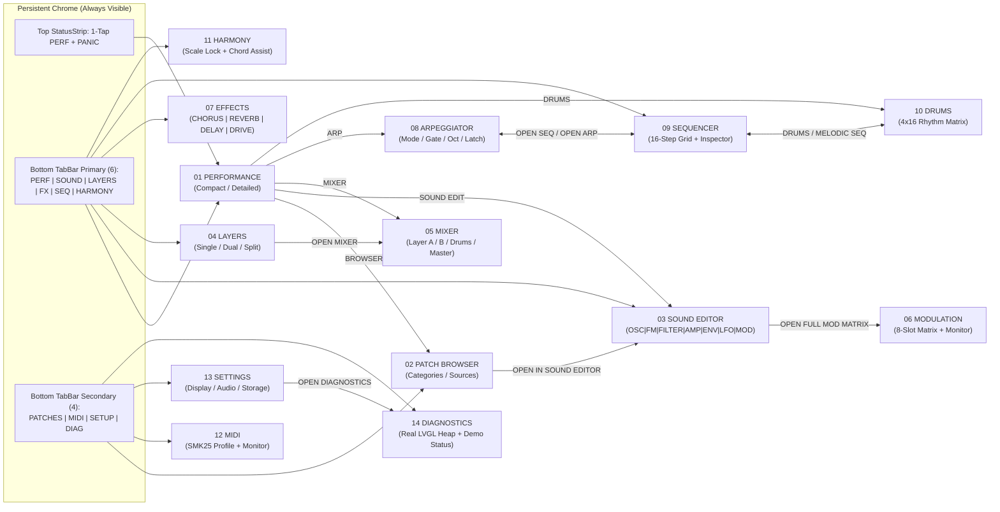

# SMK-P4 UI Blueprint 1.0 — Navigation Map & Interaction Topology

## 1. Two-Modality Navigation Architecture

Per Section 4 of the specification, the interface operates across two main workflows while preserving a **maximum of 6 primary stage destinations** on the main navigation strip and providing a **1-tap return to `PERFORMANCE`** from every screen in the system:

1. **PERFORMANCE MODE (`TELA 01 — PERFORMANCE`)**:
   - Optimized for live playing on the `800 × 480` stage screen.
   - Zero vertical scrolling; 1-tap access to `< PREV` / `NEXT >` patch, Master Volume, Expression, 4 or 8 contextual Macros, Layer Mode (`SINGLE` / `DUAL` / `SPLIT`), Octave Shift, Sustain, Panic, and Virtual Keyboard / Harmony preview.
2. **EDIT & SYSTEM MODE (`TELA 02` – `TELA 14`)**:
   - Reached via the bottom `TabBar` (`6 Primary` + `4 Secondary` buttons) or contextual launcher buttons inside `PERFORMANCE` and related editors.
   - The top `StatusStrip` (`y: 0..40`) remains visible at all times with a dedicated `PERF` return button and `PANIC` button.

---

## 2. Navigation Bar Layout (`widgets/tab_bar.cpp`)

The bottom navigation bar (`800 × 46 px`, `y: 434..480`) is divided into two distinct groups separated by an industrial divider:

### Primary Group (6 Stage/Synthesis Destinations, `x: 6..478`)
1. **`PERF`** $\rightarrow$ `ScreenId::Performance` (`TELA 01`)
2. **`SOUND`** $\rightarrow$ `ScreenId::SoundEditor` (`TELA 03`)
3. **`LAYERS`** $\rightarrow$ `ScreenId::Layers` (`TELA 04`)
4. **`FX`** $\rightarrow$ `ScreenId::Effects` (`TELA 07`)
5. **`SEQ`** $\rightarrow$ `ScreenId::Sequencer` (`TELA 09`)
6. **`HARMONY`** $\rightarrow$ `ScreenId::Harmony` (`TELA 11`)

### Secondary Group (4 Library/System Destinations, `x: 492..794`)
1. **`PATCHES`** $\rightarrow$ `ScreenId::PatchBrowser` (`TELA 02`)
2. **`MIDI`** $\rightarrow$ `ScreenId::Midi` (`TELA 12`)
3. **`SETUP`** $\rightarrow$ `ScreenId::Settings` (`TELA 13`)
4. **`DIAG`** $\rightarrow$ `ScreenId::Diagnostics` (`TELA 14`)

### Contextual Companion Screens (4 Paired Screens)
- **`TELA 05 — MIXER`**: Reached in 1 tap from `PERFORMANCE` (`MIXER` button) or `LAYERS` (`OPEN MIXER` button). Highlights `LAYERS` group in `TabBar`.
- **`TELA 06 — MODULATION`**: Reached in 1 tap from `SOUND EDITOR` (`OPEN FULL MOD MATRIX` or `MOD` sub-tab). Highlights `SOUND` group in `TabBar`.
- **`TELA 08 — ARPEGGIATOR`**: Reached in 1 tap from `PERFORMANCE` (`ARP` button) or `SEQUENCER` (`ARP` button). Highlights `SEQ` group in `TabBar`.
- **`TELA 10 — DRUMS`**: Reached in 1 tap from `PERFORMANCE` (`DRUMS` button) or `SEQUENCER` (`DRUMS` button). Highlights `SEQ` group in `TabBar`.

---

## 3. Sub-Tab Persistence & History Stack (`UiNavigationManager`)

`UiNavigationManager` (`ui_navigation.h` / `ui_navigation.cpp`) maintains:
- **History Ring Stack (`history_[16]`)**: Supports `navigateBack()` across screen transitions.
- **Persistent Sub-Tab State**:
  - `soundEditorTab()`: Remembers the last active tab (`OSC`, `FM`, `FILTER`, `AMP`, `ENV`, `LFO`, `MOD`) when switching away from `SOUND EDITOR` and returning.
  - `effectsTab()`: Remembers the last active FX tab (`CHORUS`, `REVERB`, `DELAY`, `DRIVE`) when switching away from `EFFECTS` and returning.
  - `performanceCompact()`: Preserves the user's choice between `COMPACT` (4 macros) and `DETAILED` (8 macros) on `PERFORMANCE`.
- **Guaranteed 1-Tap Return (`returnToPerformance()`)**:
  - Clears navigation history and immediately mounts `ScreenId::Performance`. Accessible from both the top-right `PERF` button in `StatusStrip` and the bottom-left `PERF` button in `TabBar`.
