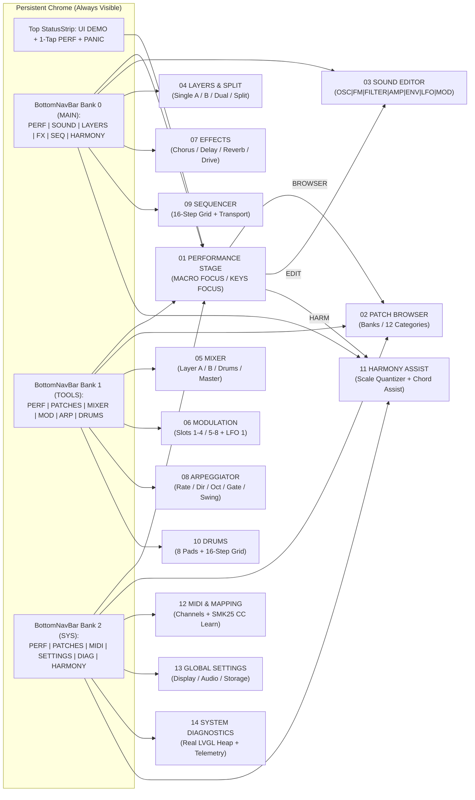

# SMK-P4 UI Blueprint 1.1 — Navigation Map & Interaction Topology

## 1. Two-Modality Navigation Architecture

The interface operates across two main workflows while keeping **6 destination buttons + 1 bank cycle button** on the bottom navigation bar and providing a **1-tap return to `PERFORMANCE`** from every screen:

1. **PERFORMANCE MODE (`TELA 01 — PERFORMANCE STAGE`, `PresentationLevel::StageMinimal`)**:
   - Optimized for live playing on the `800 × 480` stage screen with reduced badge clutter while preserving the mandatory `UI DEMO` badge in `StatusStrip`.
   - Two preserved stage layouts:
     - **`MACRO FOCUS` (`subTab = 0`)**: 4 large macros per page (`BANK: MACROS 1-4` / `BANK: MACROS 5-8`), Master Level, Octave `-`/`+`, and 1-octave keyboard.
     - **`KEYS FOCUS` (`subTab = 1`)**: 4 compact macro knobs, Master Level, Octave `-`/`+`, and full-width 2-octave keyboard (`784 × 170 px`).
2. **EDIT & SYSTEM MODE (`TELA 02` – `TELA 14`, `PresentationLevel::BlueprintVerbose`)**:
   - Reached via the banked bottom navigation bar (`BottomNavBar`) or contextual stage shortcuts (`BROWSER`, `EDIT`, `HARM`).
   - Retains full technical status badges (`AVAIL`, `PLAN`, `N/A`, `DEMO`) and diagnostic details.

---

## 2. Safe Navigation Lifecycle (`UiNavigationManager`)

`UiNavigationManager` ([`ui_navigation.h`](file:///C:/Users/devx/Documents/PlatformIO/Projects/amy/build/worktrees/smk-p4-ui-integration-ready/smk-p4/components/ui_blueprint/include/ui_navigation.h) / [`ui_navigation.cpp`](file:///C:/Users/devx/Documents/PlatformIO/Projects/amy/build/worktrees/smk-p4-ui-integration-ready/smk-p4/components/ui_blueprint/src/ui_navigation.cpp)) provides:

- **Automatic Note Release on Teardown (`unmountCurrent()`)**:
  - Calls `backend_->releaseAllUiNotes()` before `active_view_->onDestroy()` and `lv_obj_clean(content_root_)`, ensuring screen transitions never leave stuck notes.
- **In-Place Refresh (`refreshActive()`)**:
  - Updates the active screen's dynamic labels and `VirtualKeyboard` state in-place without destroying LVGL objects (used by `OCT -` / `OCT +`, `PANIC`, and `HarmonyView` key presses).
- **Deferred Navigation (`requestNavigateTo()` / `requestReturnToPerformance()` / `processPendingNavigation()`)**:
  - Allows any callback to schedule a screen transition that is executed safely at the start of `UiBlueprint::service(now_ms)`, outside of active LVGL event dispatch.
- **History Stack & Sub-Tab Persistence**:
  - Maintains a 16-entry navigation history stack for `back()` and preserves each screen's active sub-tab (`subTab(screen)`), including the user's choice of `MACRO FOCUS` (`0`) vs `KEYS FOCUS` (`1`) on `PERFORMANCE`.
