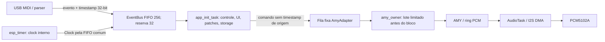
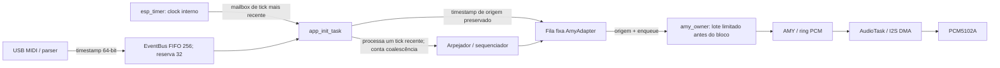

# SMK-S3 — Fase 2: relatório de execução

Data: 2026-11-01  
Estado: implementação parcial, revisão e testes host concluídos; validação final ESP32-S3 e medições físicas pendentes.

## 1. Arquitetura temporal antes e depois

### Antes

O loop de controle fazia junto MIDI, UI, patch/storage e clock. Assim, operações síncronas de armazenamento e outros trabalhos podiam atrasar processamento MIDI e ticks. O adapter descartava o timestamp original ao criar comandos. AMY já tem agenda por amostras (`amy_event.time`), mas o adapter não a alimentava.

### Depois

O clock interno não ocupa mais a FIFO de eventos gerais: um mailbox de capacidade um retém o tick mais recente e conta ticks substituídos. O controle processa o tick mais recente uma vez e não reproduz ticks acumulados em uma rajada. Clock externo é medido e entregue pelo mesmo mailbox. Timestamps de MIDI passaram a 64 bits e são preservados até o adapter; os diagnósticos separam recepção→controle, origem→owner e enqueue→owner. Foram adicionados intervalos de clock, ticks coalescidos e carga de render relativa ao deadline.

Não há conversão de microssegundos para a linha do tempo de amostras AMY nesta entrega. Portanto, preservar e medir timestamps não torna os eventos sample-accurate.

## 2. Problemas, evidência e correção

| Problema | Evidência no código | Severidade | Tratamento desta entrega |
| --- | --- | --- | --- |
| Clock interno competia com MIDI/UI na FIFO comum | callback `ClockManager` publicava `Clock` no `EventBus`; controle fazia até 10 ms de espera e outras tarefas | Alta | mailbox de tick mais recente; contadores de coalescência e atraso |
| Ticks acumulados poderiam atrasar ou reproduzir triggers em sequência | clock acionava arpejador/sequenciador pelo loop de controle | Alta | ticks substituídos não são repetidos; processa-se uma vez o contador/timestamp mais recente |
| Timestamp truncado e perdido no caminho do adapter | evento guardava 32 bits; criação do comando substituía a origem pelo enqueue | Média/alta | timestamp 64-bit e métricas de latência até o owner |
| Contagem chamada “vozes” não correspondia ao AMY | adapter rastreia referências por canal/nota, enquanto allocation/voice stealing pertence ao AMY; sustain mantém som depois do Note Off | Média | renomeada para `activeNoteReferences`/`NOTE REFS`; contagem acompanha Note On/Off aceitos, inclusive mono e referências repetidas |
| Note Off repetido podia parar uma nota sobreposta cedo | `active_notes_[channel][note]` mantinha referências, mas o release era enviado a cada Note Off | Média/alta | release ao AMY só no último Note Off correspondente |
| Mock UI usava inicialização posicional antiga do snapshot | teste host falhava por narrowing após campos de timing | Baixa | mock passou a preencher campos pelo nome |

O relatório de auditoria prévia, com mapa de filas, tarefas e riscos observados, está em [phase2_timing_audit.md](phase2_timing_audit.md).

## 3. Alterações e commits

| Entrega | Commit | Conteúdo |
| --- | --- | --- |
| A — auditoria | `0cfca8ee` | Mapa temporal, filas, ownership, agendamento AMY, limites e tabela de riscos antes de editar comportamento. |
| B — timing | `048948c2` | Mailbox de ticks; timestamps MIDI 64-bit preservados; contadores de latência/jitter/coalescência; teste wrap-safe e integração à suíte de segurança. |
| C — notas | `afba4eee` | Referência de notas repetidas e atraso de release ao AMY até a última referência. |
| D — regressão/relatório | commit final desta entrega | Regressões para Panic, sustain e mono; nomes fiéis da telemetria; relatório e resultados host. |

Não houve mudança no core upstream AMY nesta entrega. Não foi criada infraestrutura de scheduler paralela. Não foram adicionados recursos musicais ou dependências.

## 4. Testes

| Resultado | Verificação |
| --- | --- |
| PASS | `./tests/run_smk_safety.ps1` — EventBus/Panic, USB descriptor/endpoint, ciclo de vida e reconexão, proteção de áudio, CLI e utilitários de tempo. |
| PASS | `./tests/run_smk_amy_boot.ps1` — AMY real no host, incluindo referências repetidas, Note Off após Panic, sustain, mono e owner concorrente. |
| PASS | `./tests/run_smk_synth_expansion.ps1` — sequenciador, patches, macros, storage e regressões existentes. |
| PASS | `./tests/run_smk_patch_integrity.ps1` — integridade de patch e regressões FM. |
| PASS | compilação e execução host da suíte UI com os fontes de tela/driver; tela 284×76 dentro dos limites e rótulo de referências de nota. |
| PASS (revisão anterior; código ESP atual ainda precisa rebuild) | `pio run -d smk-s3 -e esp32-s3-devkitc-1` foi executado antes da última renomeação da telemetria; build com PlatformIO/ESP-IDF local terminou com RAM 29.740/327.680 bytes e flash 1.124.215/16.777.216 bytes. |
| BLOCKED | Rebuild final ESP32-S3 não executado nesta revisão: `pio` não está no PATH; `python -m platformio` seleciona PIO Core 6.1.18 em Python 3.14, rejeitado pelo PlatformIO; o Python 3.13 instalado não contém o módulo. O build local anterior usava ESP-IDF 5.5.2, enquanto CI declara ESP-IDF 5.3. |
| NOT RUN | Matriz de firmware com bloco 128 e 256 após mudanças finais; testes físicos de MIDI, saída analógica, USB disconnect/reconnect sob acorde e carga de armazenamento. |

As suítes AMY em C exibem warnings existentes de conversão de ponteiros para `long` em rotinas de diagnóstico; não são falhas do teste.

## 5. Métricas e limites

Não foram medidos latência tecla→saída analógica, jitter de execução musical, utilização real do deadline, nem underruns em placa. Os novos contadores são instrumentação, não resultados experimentais.

Configuração declarada no firmware: 48 kHz, DMA com quatro buffers; bloco 256 corresponde a 5,333 ms e 128 a 2,667 ms. Quatro buffers representam nominalmente 21,333 ms ou 10,667 ms de frames, respectivamente. Isso é capacidade configurada, não latência acústica. Os máximos de timing devem ser coletados durante a execução e reiniciados por janela; logs periódicos não imprimem por evento.

Metas provisórias (<10 ms, preferencialmente <6 ms tecla→saída e até 70% do deadline) continuam sem validação. Não afirmar áudio limpo ou prontidão para palco com base em testes host ou compilação.

## 6. Riscos remanescentes

**Comprovados pelo código, ainda sem correção completa:**

- O loop de controle ainda executa operações síncronas de Flash/NVS, patch/storage e UI. Não há limite de latência MIDI demonstrado sob essas operações.
- O mailbox escolhe o tick mais recente, mas o controle ainda pode processá-lo atrasado. Não existe limite de idade que descarte trigger vencido, nem agendamento AMY a partir do timestamp do tick.
- AMY `amy_event.time` não recebe timestamp convertido; a aplicação continua em execução na próxima janela de owner/bloco disponível.
- ClockManager não foi remodelado como estado inteiramente single-writer. Testes host cobrem mailbox e rollover, mas não uma simulação completa de BPM/swing/Start/Stop/fonte concorrentes.
- Comandos obsoletos de geração após Panic ainda podem ocupar temporariamente slots da fila AMY antes do descarte em lotes.
- `activeNoteReferences` conta referências aceitas pelo adapter, não teclas físicas, notas sustentadas, notas em release, fontes independentes, vozes alocadas ou vozes roubadas. Teclado, arp e sequenciador não têm ownership individual; o mesmo canal/nota é agregado.

**Sem evidência suficiente:**

- Não há captura de áudio ou medição que mostre que o clock mailbox reduziu jitter real.
- Não foi demonstrada a latência total com o SMK25 V2, PCM5102A, saída analógica e cabos do protótipo.
- Comportamento de troca de patch com notas ativas, voice stealing, sustain multicanal, desconexão durante acorde e interações simultâneas de sequenciador/teclado ainda requerem casos específicos de integração.

## 7. Regressões da Fase 1

Host PASS para validação de descritores/endpoints USB, transferências, falhas de lifecycle, disconnect/reconnect, reserva de releases/Panic, eventos concorrentes e proteção do áudio. Isso demonstra as propriedades cobertas pelos testes host; não demonstra comportamento elétrico do host USB na placa.

## 8. Próxima etapa

Antes de ampliar para layers, scenes e performance: restaurar ambiente PlatformIO compatível e passar ESP-IDF 5.3 nas configurações 128/256; em seguida criar um teste com relógio simulado que fixe política de tick atrasado, BPM/swing/Stop e preservação de Note Off. Depois medir em hardware a latência e jitter com captura simultânea de MIDI e saída analógica, inclusive durante save/load e carga UI. Só então decidir se a próxima mudança deve mover trabalho de Flash ou ancorar eventos ao tempo de amostras AMY.
